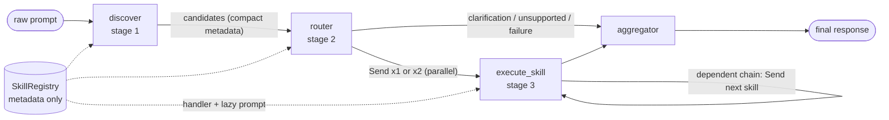

# Architecture

Goal: a four-skill agent whose architecture can grow to tens or hundreds of skills **without**
(a) editing the router for each new skill, (b) growing the LangGraph graph, or (c) growing the
LLM routing context in proportion to the number of skills.

## 1. Request flow

1. **Entry.** `run_request` invokes the compiled graph with `{"original_prompt": text}`; a fresh
   `AgentState` is created for every request (no checkpointer, no history). The original prompt is never
   modified; a normalised copy (`normalized_prompt`) is used only for discovery/heuristics.
2. **Stage 1 - `discover` node** (`app/routing/discovery.py`): shrink the registry to a shortlist using
   compact metadata only. No full prompt is loaded and, normally, no LLM is called.
3. **Stage 2 - `router` node** (`app/routing/router.py`): one LLM call whose prompt contains the generic
   router rules plus **only the shortlisted skills' metadata lines**. The JSON reply is validated by
   `RoutingDecision` + `check_against(shortlist)`.
4. **Stage 3 - `execute_skill` node** (`app/graph/nodes.py`): invoked once per selected skill through
   LangGraph `Send`; it looks the skill up in the registry and calls its handler, which lazily loads
   its own prompt. It receives a `SkillTask` (skill id, original prompt, optional previous output, language) -
   nothing about other skills.
5. **`aggregator` node:** builds the final response without an LLM call: clarification question,
   unsupported-request message, a single result, the last step of a chain, or labelled sections for
   independent results; skill errors are appended.

The graph has **four nodes and a constant number of edges regardless of the number of skills**
(`tests/test_graph.py::test_graph_has_constant_node_set`).

## 2. Skill contract and registry

`app/skills/base.py`:

| Piece | Purpose |
|---|---|
| `SkillMetadata` (Pydantic, frozen, `extra="forbid"`) | `id`, `name`, `description` (<=200 chars), `input_types`, `operations`, `routing_examples` (<=4, <=120 chars each), `keywords` (regexes for stage 1), `routing_hint`, `is_fallback`, `accepts_previous_output`, `requires_content` + `missing_input_question`, `result_labels` |
| `Skill` | `metadata` + `handler(SkillContext) -> str` (the execution handler) |
| `SkillContext` | `llm`, original `prompt`, optional `previous_output`, `language` |

`SkillMetadata` validates at construction: snake_case id, description/example length limits,
non-empty lists, compilable keyword regexes, consistent flags; unknown fields (e.g. a stray `prompt`)
are rejected, so a full prompt cannot leak into routing metadata.
`app/skills/registry.py` `SkillRegistry.register` rejects non-`Skill` objects, duplicate ids and a second
fallback skill; `get` raises `RegistryError` for unknown ids.

**Adding a skill** = one new module in `app/skills/` that defines `METADATA`, a `run(ctx)` function and
`SKILL = Skill(METADATA, run)`; `discover_builtin_skills()` registers every module that exposes `SKILL`.
No change to the router, edges, graph builder, state or schemas
(`tests/test_registry.py::test_new_skill_works_end_to_end_without_touching_router_or_graph`).
Skill-specific knowledge is isolated in its own module: routing keywords, boundary hints
(`routing_hint`), what to ask when input is missing, result labels, and the prompt file.
The generic prompts (`router.txt`, `shortlist.txt`) contain no skill names or skill-specific rules.

## 3. Context management (how explosion is prevented)

What the router LLM receives per request:

| Part | Size | Depends on N (registered skills)? |
|---|---|---|
| `router.txt` rules | ~2.5k chars (fixed) | no |
| Candidate lines (`render_candidate`) | ~220 chars each (measured on synthetic skills), K <= 5 (+ fallback) | no - bounded by K |
| User prompt | the user's text | no |
| Full skill prompts | **0** (never in routing) | no |

Stage-1 strategies (`Discovery.strategy`):

| Strategy | When | Cost |
|---|---|---|
| `all` | registry <= 6 skills (the 4-skill prototype) | all compact lines, no extra work |
| `lexical` | larger registry and at least one keyword/overlap match | deterministic scoring, **no LLM call**; top K=5 + fallback skill |
| `llm_shortlist` | larger registry, no lexical match | one extra LLM call over a compact index (`id: description[:90]`) - O(N) but tiny: measured 4.4k chars at N=50, 8.7k at N=100, 17.4k at N=200 |
| `fallback_only` | nothing matched and the shortlist failed | only the fallback skill (general chat) is offered; the router can still answer "unsupported" |

Lazy loading: full prompts live in `app/prompts/*.txt` (or any `PromptStore` source) and are read only by
the selected skill's handler through `PromptStore.load`. `PromptStore.accessed` records every load, which
tests and the simulation assert on.

**Measured behaviour** (`python -m evaluation.scalability`, 20 queries per size, synthetic skills, stub
router, results in `evaluation/results/scalability.md`): with 11 -> 201 registered skills the average
routing context stays ~3.9k characters (~970 tokens by the chars/4 approximation), the number of
candidates stays 6, full prompts loaded before execution = 0, and after execution = 1 (the selected
skill) with no unselected prompt ever accessed. Injecting every skill's metadata and full prompt would
cost 42.5k -> 736.5k characters over the same range (11x -> 189x more).

Trade-offs and limits:
- Stage 1 is a recall bottleneck: a skill with no keyword/vocabulary overlap is only found through the
  `llm_shortlist` path (which sees only `id: description`). Good skill descriptions and keywords matter.
  At thousands of skills the compact index itself would need a category tree or embeddings; deliberately
  not built for this prototype (no vector DB).
- For <= 6 skills the shortlist is the whole registry, so the saving appears only as the registry grows.
- Shortlist rates in the simulation use synthetic data written by the same author; they demonstrate
  mechanics, not real-world recall. Live LLM routing was measured separately (README section 8: 15/15 on the small dataset).

## 4. Query categories and how they are handled

See [docs/query_categories.md](docs/query_categories.md) (examples and expected routing for each category).

## 5. Selection rules, errors and fallback policy

| Situation | Outcome |
|---|---|
| 1 or 2 valid candidate ids | executed |
| > 2 ids, duplicates, unknown / non-shortlisted ids, fallback combined with another skill, bad types | `RoutingDecision`/`check_against` reject -> one corrective retry -> deterministic keyword router |
| Greeting, small talk, general knowledge | fallback skill `general_chat` (a normal match) |
| Needs an action or capability no skill has and chat cannot answer from knowledge (booking, sending, live data, files) | `unsupported_request` -> clear "not supported" message listing what is supported; **no skill runs** |
| Input missing / goal too vague, or confidence < 0.4 | clarification question in the user's language; no skill runs |
| LLM provider error in the router | no guessing; error message to the user |
| Keyword fallback finds nothing and there is no fallback skill | unsupported |
| Empty input | "Please type a request." without an LLM call |

This reconciles the interviewer's "return an error when no skill fits" with the original brief's General Chat
and fallback requirements: conversation is a *match* for General Chat; only requests that nothing (including
chat) can serve return the error; ambiguity asks; an unrelated skill is never executed silently.

## 6. Two skills: parallel or sequential

Decided from actual dependencies, not fixed pairs:
- The router sets `depends_on_previous` when the second skill must work on the first one's output.
- Policy guard (`apply_policy`): the flag is honoured only if the second skill's metadata says
  `accepts_previous_output`; otherwise it is downgraded to parallel and a routing note is recorded.
- **Sequential:** `route_after_router` dispatches the first skill only; `route_after_skill` dispatches the
  next skill with `previous_output`. The final answer is the last step. A failure stops the chain.
- **Parallel:** `route_after_router` returns two `Send` objects, so both skills run in the same LangGraph
  super-step; each receives only the original prompt; the aggregator labels the sections in router order.
- The dependency/limit rules are generic: no skill names appear in `edges.py`.

## 7. State and Persian handling

`AgentState` (`app/graph/state.py`) holds the original and normalised prompt, language, discovery
(`candidate_skills`, `registered_skill_count`, `discovery_strategy`), routing (`selected_skills`,
`depends_on_previous`, confidence, source, `routing_context_chars`, notes, clarification, unsupported)
and results (`skill_results`, `errors` with reducers for parallel writes, `final_response`).
Persian: `app/utils/language.py` normalises letters, digits (Persian/Arabic-Indic -> ASCII),
punctuation, ZWNJ and whitespace; language detection counts letters only; stage-1 keywords are
bilingual; skills receive the original text; calculator replies for Persian requests use Persian digits.

## 8. Calculator

The LLM only extracts an expression (`ExpressionExtraction`, one corrective retry); `safe_calculator`
evaluates it with an AST whitelist (no `eval`/`exec`), limits on length, integer power size and
factorial, and clear errors for division by zero, domain errors and non-finite results. The reply is
built in code, so the number never comes from the LLM.

## 9. Known limitations of this design

- The generic router prompt scored 15/15 live on the small dataset (README section 8), as did the naive v1 prompt, so the
  dataset cannot separate them; the earlier hand-written few-shot router was never measured live.
- Sequential chains show only the last output.
- The keyword fallback router cannot detect unsupported requests (it falls back to general chat); the
  offline baseline reports this honestly.
