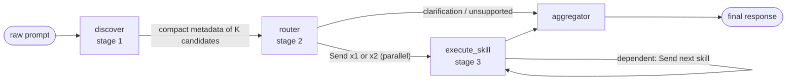

# I4Twins multi-skill AI agent

> **Built with Claude Code.** This whole repository (code, tests, prompts, evaluation and documentation) was written
> with the help of Anthropic's AI coding assistant, Claude Code, under the standing instructions in
> [CLAUDE.md](CLAUDE.md). Details of what the assistant did and what was and was not verified: [AI_USAGE.md](AI_USAGE.md).

A command-line and web-UI agent built with **LangGraph** and **Pydantic**. A free-form prompt (English or Persian) is
routed to up to two of exactly four skills - **Summarizer, Translator, Calculator (real tool), General Chat** -
through a **skill registry and a two-stage router** designed to scale to many more skills without growing the
LLM context or the graph.

> **Honest status (17 Nov 2026).** Verified locally: 219 offline unit tests pass; the graph builds; the CLI and the
> Streamlit UI start; the offline evaluation, the scalability simulation and the live routing evaluation (OpenRouter,
> `google/gemma-4-31b-it`) were run. **Still only lightly measured:** answer quality of summaries/translations/Persian
> output (a handful of hand-checked samples, no systematic review). See [Remaining actions](#remaining-actions-for-the-author).

**Contents:** [Quick start from zero](#quick-start-from-zero) - [Models](#models-used-in-the-code) -
[Architecture](#1-architecture-at-a-glance) - [Evaluation](#8-evaluation) - [Web interface](#8b-local-web-interface) -
[Tests](#9-tests) - [Troubleshooting](#troubleshooting)

Docs: [PROJECT_SPEC](PROJECT_SPEC.md) - [INTERVIEWER_REQUIREMENTS](INTERVIEWER_REQUIREMENTS.md) -
[ARCHITECTURE](ARCHITECTURE.md) - [IMPLEMENTATION_PLAN](IMPLEMENTATION_PLAN.md) -
[query categories](docs/query_categories.md) - [prompt engineering](docs/prompt_engineering.md) -
[CLAUDE.md](CLAUDE.md) - [AI_USAGE](AI_USAGE.md)

## Quick start from zero

Works on Windows, macOS and Linux. Commands are shown for Windows PowerShell first, with the macOS/Linux form beside them.

### Step 1 - Install the tools

| Tool | Version | Check |
|---|---|---|
| Python | 3.11 or newer (developed on 3.14) from https://www.python.org/downloads/ (on Windows tick "Add python.exe to PATH") | `python --version` |
| Git | any recent version from https://git-scm.com/downloads | `git --version` |

### Step 2 - Get the code

```bash
git clone https://github.com/<owner>/<repo>.git
cd <repo>
```

(Replace `<owner>/<repo>` with this repository's address, or download the ZIP from GitHub and unzip it.)

### Step 3 - Create a virtual environment and install the dependencies

```bash
python -m venv .venv
.venv\Scripts\activate            # macOS/Linux: source .venv/bin/activate
pip install -r requirements.txt
```

Your prompt now starts with `(.venv)`. Every new terminal needs the `activate` line again.

### Step 4 - Create a free OpenRouter account and an API key

The agent talks to language models through [OpenRouter](https://openrouter.ai), one account that gives access to many models.

1. Open https://openrouter.ai and click **Sign in / Sign up**. Register with Google, GitHub or an e-mail address, and confirm
   the e-mail if asked.
2. Open **Keys** (https://openrouter.ai/keys) and click **Create API Key**. Give it a name (for example `i4twins`).
   Optionally set a **credit limit** on the key so a leak can never cost much.
3. **Copy the key now** (it starts with `sk-or-v1-` and is shown only once).
4. Free vs paid models:
   - `:free` models cost nothing and need no payment, but they share a pool with all other users and are often
     **rate limited (HTTP 429)**. Expect "rate limit reached" errors at busy times.
   - Paid models are used with prepaid credits (Settings -> Credits). The models in this project cost fractions of a cent per
     request; a few dollars of credit is plenty. Paid models are the reliable choice and the ones used for the measured results.

Treat the key like a password: never paste it into the code, an issue, a screenshot or a commit.

### Step 5 - Configure the project

```bash
copy .env.example .env                # macOS/Linux: cp .env.example .env
```

Open `.env` in any editor and set your key and a model:

```
LLM_PROVIDER=openrouter
OPENROUTER_API_KEY=sk-or-v1-...your key...
LLM_MODEL=google/gemma-4-31b-it
```

`.env` is listed in `.gitignore`, so it is never committed. Only `.env.example` (placeholders) is in the repository.

### Step 6 - Run it

```bash
python main.py                                  # interactive CLI; every line is an independent request
python main.py "What is 245 * 36?"              # a single request
python main.py "Translate 'hello' to German and calculate 12*12"
python main.py -v "حاصل ۲۵ ضربدر ۴۸ چیست؟"       # -v: discovery, routing context size, confidence, notes
streamlit run ui.py                             # web interface at http://localhost:8501
```

### Step 7 - Verify the installation (optional, needs no key)

```bash
python -m pytest                          # 219 offline tests with a fake LLM
python -m evaluation.evaluate --offline   # keyword-router baseline, no key
python -m evaluation.evaluate             # live routing evaluation (needs a key and credits)
python -m evaluation.scalability          # context-management simulation
```

### Troubleshooting

| Message | Meaning and fix |
|---|---|
| `OPENROUTER_API_KEY is not set` | `.env` is missing or still holds the placeholder. Redo Step 5. |
| `rate limit reached for ...:free` | The free model is busy. Wait a minute, or set `LLM_MODEL=google/gemma-4-31b-it` (paid, needs credits). |
| `authentication failed` | Wrong or revoked key. Create a new one and update `.env`. |
| `provider returned HTTP 402` | The account has no credits for a paid model. Add credits in OpenRouter, or use a `:free` model. |
| `could not reach the provider` | No internet connection or a proxy/firewall blocks `openrouter.ai`. |
| Persian looks left-to-right in the console | The classic Windows console cannot shape Persian. Use Windows Terminal or the web UI. |
| `streamlit` not found | The virtual environment is not active, or `pip install -r requirements.txt` was not run. |

## Models used in the code

All models are called through OpenRouter and are at most 35B parameters. Model ids can be changed without touching code.

| Where | Model id | Notes |
|---|---|---|
| Default (`.env.example`, `app/config.py`) | `google/gemma-4-31b-it:free` | Google Gemma 4 31B, free, shared pool, often rate limited |
| Recommended / used for all measured results | `google/gemma-4-31b-it` | same model, paid (about 0.2 USD per million input tokens) |
| Web UI second choice | `qwen/qwen3-32b` | Alibaba Qwen3 32B, paid and cheap. **OpenRouter lists no free Qwen model** |
| Optional alternative | `google/gemma-4-26b-a4b-it:free` | free, same upstream pool as the 31B |

The list shown in the web UI lives in [app/models.py](app/models.py). The skills and the router use whichever single model
is configured (`LLM_MODEL`), or the model(s) chosen in the UI. Prices and availability change; check https://openrouter.ai/models.

## 1. Architecture at a glance



Four graph nodes, whatever the number of skills. Skills are plugins (`app/skills/*.py`) exposing compact metadata
plus a handler; a central `SkillRegistry` validates and serves them. Details: [ARCHITECTURE.md](ARCHITECTURE.md).

Stack: Python 3.11+ (developed on 3.14), LangGraph, langchain-openai (OpenRouter client only), Pydantic v2,
python-dotenv, Typer + Rich, Streamlit (web UI), pytest.

## 2. Configuration reference

| Variable | Default | |
|---|---|---|
| `LLM_PROVIDER` | `openrouter` | only OpenRouter is implemented |
| `OPENROUTER_API_KEY` | required | key from https://openrouter.ai/keys |
| `LLM_MODEL` | `google/gemma-4-31b-it:free` | change model without touching code |
| `OPENROUTER_BASE_URL`, `LLM_TEMPERATURE` (0.2), `LLM_TIMEOUT_SECONDS` (90), `LLM_MAX_RETRIES` (4) | | optional |

Without a key the CLI exits with a configuration error (code 2). Run `python main.py --help` for the CLI options.

## 3. LLM provider and model

| | |
|---|---|
| Provider | OpenRouter, free tier |
| Model id | `google/gemma-4-31b-it:free` (Google Gemma 4 31B Instruct) |
| Parameters | **30.7B dense** (<= 35B), from the model description in OpenRouter's public model list |
| Free-tier status | pricing `0`/`0` (prompt/completion) in `https://openrouter.ai/api/v1/models`, **verified 16 Nov 2026** |
| Listed capabilities | tool calling, `response_format`, 256K context |
| Alternative | `google/gemma-4-26b-a4b-it:free` (also free; set `LLM_MODEL`) |

Not verified: Persian quality and JSON reliability in practice. Free models can be rate limited (HTTP 429): the client
retries with back-off, then reports a clean error. If the id disappears, set another qualifying `LLM_MODEL`.

## 4. Skills

| Skill | Module | Notes |
|---|---|---|
| Summarizer | `app/skills/summarizer.py` + `prompts/summarizer.txt` | faithful, no invented facts, length control, same language unless asked |
| Translator | `translator.py` + prompt | auto-detect source, infer target (fa->en, else ->fa), keep names/numbers/format, never summarize |
| Calculator | `calculator.py` + `tools/safe_calculator.py` | LLM only extracts the expression; the tool computes; the reply is built in code |
| General Chat | `general_chat.py` + prompt | fallback skill: greetings, general knowledge; never fakes another skill |

Calculator safety: `ast` whitelist (no `eval`/`exec`), function/constant whitelist, 200-char limit, integer-power
and factorial limits, clear errors (division by zero, domain, non-finite), Persian/Arabic digits normalised,
`15%` -> `(15/100)`. Tests prove the number comes from the tool (`test_result_comes_from_the_tool_not_the_llm`).

## Scalable Skill Registry and Context Management

**Problem.** If the router received every skill's description, examples and full prompt, its context would grow with the
number of skills (50-100 skills = unreliable and expensive), and a per-skill graph/router would need edits for every new
skill.

**Design.**
1. **Registry with compact metadata.** Each skill declares `SkillMetadata` (id, name, description <= 200 chars,
   input types, operations, <= 4 short routing examples, keyword regexes, a routing hint, flags) and a handler.
   Metadata is validated at construction/registration; duplicate ids, invalid definitions and unknown fields are
   rejected. Full prompts are *not* metadata.
2. **Stage 1 - discovery** (`app/routing/discovery.py`): <= 6 skills -> all compact lines; larger registries ->
   deterministic lexical scoring (no LLM call) -> top 5 + the fallback skill; no match -> one cheap LLM call over a
   compact `id: description` index; still nothing -> fallback skill only.
3. **Stage 2 - focused routing** (`app/routing/router.py`): the generic router prompt (no skill names) is rendered with
   only the shortlisted candidates; the JSON decision is validated (ids must be in the shortlist, <= 2 skills, no
   duplicates, no fallback combos) with one corrective retry, then a deterministic keyword fallback.
4. **Stage 3 - isolated execution**: `execute_skill` runs each selected skill via LangGraph `Send` with only
   `(skill id, original prompt, optional previous output, language)`; the skill's handler lazily loads its own prompt.
5. **Constant graph**: `discover -> router -> execute_skill -> aggregator`. A new skill is one new file in `app/skills/`.

**Measured** (`python -m evaluation.scalability`, 20 queries per size, synthetic skills that exist only in
`evaluation/synthetic_registry.py`, deterministic stub instead of an LLM; full table in
`evaluation/results/scalability.md`; `~tokens` = chars/4, an approximation):

| Registered (incl. 1 fallback) | Avg candidates | Avg selected | Full prompts loaded before execution | Loaded after execution | Unselected prompt accessed | Avg routing context | If all metadata + full prompts were sent |
|---|---|---|---|---|---|---|---|
| 11 | 6.0 | 1.0 | 0 | 1.0 | no | 3,871 chars (~968 tokens) | 42,547 chars (~10,636) |
| 51 | 6.0 | 1.0 | 0 | 1.0 | no | 3,895 chars (~974) | 188,698 chars (~47,174) |
| 101 | 6.0 | 1.0 | 0 | 1.0 | no | 3,892 chars (~973) | 371,301 chars (~92,825) |
| 201 | 6.0 | 1.0 | 0 | 1.0 | no | 3,893 chars (~973) | 736,507 chars (~184,126) |

The routing context stays flat (it depends on K, not on N); no unselected prompt is ever touched.
For the real 4-skill app, the router system prompt is 4,271 characters (template 2,542 + four compact lines), and the four
full skill prompts (969-1,809 chars each) are never part of it.

**Trade-offs and limits.**
- Recall is bounded by stage 1: a skill sharing no vocabulary with the request is found only via the LLM-shortlist path
  (which sees `id: description` only). Good descriptions/keywords are part of adding a skill. That index is O(N) but tiny
  (measured 4.4k chars at 50 skills, 8.7k at 100, 17.4k at 200); beyond hundreds of skills a category tree or embeddings
  would be the next step (deliberately not built: no vector DB for a prototype).
- With <= 6 skills the shortlist is the whole registry, so savings appear only as the registry grows.
- The simulation uses synthetic data and a stub; its shortlist rate (100%) is a sanity check, not a recall benchmark.
- Live routing was measured once on the 15-prompt dataset (section 8); the dataset is small and written by the same author, so it is not a recall benchmark.

## 5. Routing, multi-skill execution and fallback

- Router output is validated by `RoutingDecision` (`app/schemas/routing.py`): <= 2 skills, no duplicates, confidence in
  [0, 1], ISO language code, consistent clarification and unsupported fields; ids are checked against the shortlist
  (`check_against`). Invalid output -> one retry quoting the error -> keyword router; never accepted silently.
- **Two skills:** dependent pairs run **sequentially** (second gets the first's output; the router sets
  `depends_on_previous`, honoured only if the second skill's metadata says `accepts_previous_output`); independent pairs
  run **in parallel** (two `Send`s in one super-step) and the answer shows labelled sections. A failed first step stops a chain.
- **Fallback / error policy:** greetings and general questions -> General Chat; requests needing an action or live data
  that no skill (and not chat) can do -> **clear "not supported" answer, no skill runs**; missing input or confidence < 0.4
  -> clarification question; provider error -> error message, no guessing; empty input -> "Please type a request.".
- Query categories with examples: [docs/query_categories.md](docs/query_categories.md).

## 6. Persian support

`app/utils/language.py`: Arabic letters -> Persian, Persian/Arabic-Indic digits -> ASCII, Persian punctuation -> ASCII,
tatweel/diacritics/bidi marks removed, ZWNJ and spaces collapsed; letter-only language detection (so `۲۵*۴۸` is
"unknown", not English). The original prompt is never modified; skills receive the original text; the normalised copy
serves discovery/heuristics/calculator parsing. Skill keywords are bilingual; Persian calculator answers use Persian
digits; prompts require natural Persian with half-spaces. Tested per skill in `tests/test_persian.py`.
Limits: Arabic-script text without Persian-specific letters is labelled `ar`; Persian number words rely on the LLM.

## 7. Prompt engineering

One prompt file per skill in `app/prompts/` (`router`, `shortlist`, `summarizer`, `translator`, `calculator`,
`general_chat`); the router prompt is skill-agnostic and rendered from candidate metadata. Before/after analysis and a
reproducible router A/B command: [docs/prompt_engineering.md](docs/prompt_engineering.md). **The summarizer/translator
before/after analysis is reasoned from known failure modes; live outputs of their "before" prompts have not been recorded. The router A/B
was measured live (section 8) and showed no difference on this dataset.**

## 8. Evaluation

Dataset: `evaluation/dataset.json`, 15 fixed prompts (6 Persian; single skill, 3 two-skill incl. sequential and parallel,
2 ambiguous, 1 unsupported, 2 edge cases). Metrics: exact skill-set accuracy, per-skill precision/recall/F1, multi-skill
accuracy, clarification accuracy, unsupported-request accuracy, Persian accuracy.

| Run | Status |
|---|---|
| **Offline keyword router (no LLM)** `python -m evaluation.evaluate --offline` | **Measured 16 Nov 2026**: exact skill-set accuracy 93.3% (14/15), multi-skill 100% (3/3), clarification 100%, unsupported 93.3%, Persian 100% (6/6). The one miss is the unsupported "Book me a flight" prompt: the keyword router cannot detect unsupported requests and falls back to general chat. The dataset and keywords were written by the same author, so this is a baseline, not evidence about the LLM. File: `evaluation/results/offline_baseline.md` |
| **Live LLM router** `python -m evaluation.evaluate` | **Measured 16 Nov 2026** (UTC) with `google/gemma-4-31b-it` via OpenRouter: exact skill-set accuracy 100% (15/15), multi-skill 100% (3/3), clarification 100%, unsupported 100%, Persian 100% (6/6). The unsupported prompt that the keyword router missed was routed correctly. One run, 15 prompts, no confidence interval. The free variant `:free` was rate-limited upstream (HTTP 429) during testing and could not be evaluated. File: `evaluation/results/live_router.md` |
| Router prompt A/B (`--router-prompt evaluation/router_v1_naive.txt`) | **Measured 16 Nov 2026**: the naive v1 prompt also scored 100% on every metric, so this dataset **does not separate** the two prompts; the final prompt's advantage (skill-agnostic, scales with candidates) is architectural, not shown by accuracy. File: `evaluation/results/live_router_v1_naive.md` |
| Skill output quality (summary/translation) | **Spot-checked only** (17 Nov 2026, 4 prompts, no systematic scoring): a one-sentence summary followed the length request and kept the 90% figure; EN->FA translation was natural Persian; the Persian calculator prompt returned `15/100*240+7 = 43` in Persian digits (correct, computed by the safe calculator); the sequential "translate to French and then summarize" prompt returned an **English** summary, i.e. the final output is not in the intermediate (French) language, a possible defect to investigate. Not a quality benchmark. |

## 8b. Local web interface

```bash
streamlit run ui.py        # opens http://localhost:8501 (needs the key from Quick start, step 5)
```

Pick one model, or two to compare side by side; both answers are produced in parallel and you press "This answer is better"
under the one you prefer (the choice lives only on the screen; nothing is stored). Models are listed in `app/models.py`
(Gemma 4 31B paid, Gemma 4 31B free, Qwen3 32B). **OpenRouter lists no free Qwen model**, so Qwen3 32B is the paid (cheap)
variant. Each output line is aligned by its own script: lines with Persian letters are right-to-left and right-aligned;
English text and numbers are left-to-right and left-aligned (`app/utils/bidi.py`). The server is bound to `localhost`
(`.streamlit/config.toml`) because it uses your API key. It is a local in-process UI, not a web API: the graph is called
directly and there is no HTTP endpoint, storage or authentication.

Observed in one manual comparison (not a benchmark): for the Persian prompt "translate to English: جلسه به بعدازظهر پنجشنبه
منتقل شد", Gemma 4 31B wrote "Thursday afternoon" and Qwen3 32B wrote "Friday afternoon" (a mistranslation); both handled
"calculate 12*12" correctly (144, computed by the safe calculator).

## 9. Tests

```bash
python -m pytest        # 219 offline tests, fake LLM
```

They validate code and architecture (schemas, retry/fallback, calculator safety, registry, discovery, lazy loading,
sequential/parallel execution, unsupported/ambiguous handling, Persian per skill, configuration, metrics, scalability
simulation), **not** LLM answer quality.

## Architecture review

An independent review pass (by the AI assistant, against the original brief and the interviewer's clarifications) found and
fixed these defects:

| Finding | Fix |
|---|---|
| `router.txt` still contained skill-specific vocabulary/examples (coupling the router to the four skills) | Made the prompt skill-agnostic; boundary rules moved to each skill's `routing_hint` |
| Empty prompt on a large registry without a fallback skill crashed with `IndexError` | Clarification decisions may carry no skill; test added |
| Empty prompt on a large registry triggered a needless LLM-shortlist call | Skipped for blank prompts; test added |
| An empty registry was silently replaced by the default one (`registry or ...`) | Explicit `None` check; empty registry rejected; test added |

Checked and confirmed: new skills need no router/graph/schema edit (`test_new_skill_works_end_to_end_without_touching_router_or_graph`);
context explosion is prevented in code, not only in docs (`test_routing_context_stays_flat_as_the_registry_grows`,
`test_unselected_full_prompts_are_never_loaded`); metadata is separated from prompts (`extra="forbid"`, lazy `PromptStore`);
LangGraph is used for state, conditional routing, parallel `Send` fan-out and chaining. Remaining weaknesses: live routing
quality and Persian output quality are unmeasured; stage-1 recall depends on skill descriptions/keywords; chains show only
the last output; this is an AI self-review, not a human one.

## Requirement compliance matrix

Status: **Impl** = implemented and covered by offline tests; **Live?** = additionally depends on a real LLM (see section 8 for what was measured).

| ID | Requirement | Module | Test | Docs |
|---|---|---|---|---|
| O-1 | Exactly 4 skills | `app/skills/{summarizer,translator,calculator,general_chat}.py` | `test_graph.py::test_exactly_four_registered_skills`, `test_registry.py::test_default_registry_has_exactly_the_four_required_skills` | README s.4 |
| O-1 | Calculator is a real tool | `app/tools/safe_calculator.py`, `app/skills/calculator.py` | `test_calculator.py::test_result_comes_from_the_tool_not_the_llm`, `test_invalid_or_unsafe_expressions` | README s.4 |
| O-2 | Router -> skills with original prompt -> response; Pydantic-validated routing | `app/routing/router.py`, `app/schemas/routing.py`, `app/graph/` | `test_router.py::test_invalid_decisions_rejected`, `test_graph.py::test_original_prompt_is_preserved` | ARCHITECTURE s.1 |
| O-3 | <= 2 skills; combination strategy explained | `app/graph/edges.py`, `RoutingDecision` | `test_multiskill.py::test_sequential_chain_passes_output_forward`, `test_independent_skills_run_both_and_are_labelled`, `test_unsupported.py::test_at_most_two_skills_are_ever_executed` | ARCHITECTURE s.6, README s.5 |
| O-4 | Fallback for no-match / ambiguous | `app/routing/heuristic.py`, `app/graph/nodes.py` (aggregator) | `test_router.py::test_unknown_skill_id_triggers_retry_and_then_fallback`, `test_unsupported.py::*`, `test_graph.py::test_router_fallback_still_answers` | ARCHITECTURE s.5, README s.5 |
| O-5 | Persian routing and output | `app/utils/language.py`, bilingual keywords/prompts | `tests/test_persian.py::*` | README s.6 |
| O-6 | Free provider, model <= 35B | `app/config.py`, `app/llm.py` | `test_graph.py::test_settings_from_env_and_key_never_in_repr` | README s.3 (**Live?** quality) |
| O-7 | LangGraph graph; CLI only | `app/graph/builder.py`, `app/cli.py`, `main.py` | `test_graph.py::test_graph_has_constant_node_set` | ARCHITECTURE s.1 |
| O-8 | Out-of-scope items absent (no DB/memory/API/auth) | - (nothing implemented) | `test_graph.py::test_each_request_starts_with_a_fresh_state` | README s.1 |
| O-9 | README contents | `README.md` | - | README |
| O-10 | 10-15 prompt evaluation with routing accuracy | `evaluation/dataset.json`, `evaluate.py`, `metrics.py` | `test_evaluation.py::*` | README s.8 (**Live?** not run) |
| O-11 | Before/after prompt example | `app/prompts/*`, `evaluation/router_v1_naive.txt` | `test_summarizer.py::test_prompt_contract_mentions_faithfulness_and_length`, `test_translator.py::test_prompt_forbids_summarizing_and_commentary` | docs/prompt_engineering.md (**Live?** outputs not recorded) |
| O-12 | Clean git history, feature branches | git | - | IMPLEMENTATION_PLAN |
| I-1.1 | Common skill interface | `app/skills/base.py` (`Skill`, `SkillContext`) | `test_registry.py::test_skill_runs_through_its_handler` | ARCHITECTURE s.2 |
| I-1.2 | Central registration/discovery, minimal change to add | `app/skills/registry.py`, `app/skills/__init__.py` | `test_new_skill_is_registered_and_discovered`, `test_new_skill_works_end_to_end_without_touching_router_or_graph`, `test_new_skill_can_chain_with_an_existing_one` | ARCHITECTURE s.2 |
| I-1.3 | Router discovers skills via metadata | `app/routing/router.py::render_candidate` | `test_router.py::test_router_prompt_contains_only_compact_metadata` | ARCHITECTURE s.3 |
| I-1.4 | Metadata fields (id, name, description, input types, operations, handler, examples) | `SkillMetadata`, `Skill.handler` | `test_registry.py::test_every_skill_has_complete_metadata` | ARCHITECTURE s.2 |
| I-1.5 | Validation; duplicates rejected | `SkillMetadata` validators, `SkillRegistry.register` | `test_duplicate_skill_ids_are_rejected`, `test_invalid_metadata_is_rejected`, `test_registering_a_non_skill_is_rejected`, `test_non_callable_handler_is_rejected` | ARCHITECTURE s.2 |
| I-1.6 | Skill details isolated from routing | skill modules own keywords/hints/labels/prompts | `test_router.py::test_router_prompt_contains_only_compact_metadata` | ARCHITECTURE s.2 |
| I-1.7 | Exactly four skills initially; no demo skills in the app | `app/skills/` | `test_scalability.py::test_synthetic_registry_is_bounded_and_separate_from_the_app` | CLAUDE.md |
| I-2.1 | Stage 1 lightweight discovery | `app/routing/discovery.py` | `test_discovery.py::test_large_registry_is_narrowed_lexically`, `test_no_lexical_match_uses_llm_shortlist_over_a_compact_index` | ARCHITECTURE s.3 |
| I-2.2 | Stage 2 focused selection, <= 2, ids validated | `app/routing/router.py`, `RoutingDecision.check_against` | `test_router.py::test_unknown_skill_id_rejected_against_registry`, `test_more_than_two_skills_is_never_accepted` | ARCHITECTURE s.1/s.5 |
| I-2.3 | Stage 3 isolated execution | `app/graph/nodes.py::execute_skill`, `SkillTask` | `test_discovery.py::test_only_the_selected_real_skill_prompt_is_loaded_and_sent` | ARCHITECTURE s.1 |
| I-2.4 | Router never gets full prompts; lazy loading; compact metadata | `PromptStore`, `render_candidate` | `test_no_full_prompt_is_loaded_during_discovery_and_routing`, `test_unselected_full_prompts_are_never_loaded` | README "Scalable Skill Registry..." |
| I-2.5 | No vector DB/infrastructure | lexical scoring | - | ARCHITECTURE s.3 |
| I-2.6 | Context behaviour documented | - | `test_scalability.py::*` | ARCHITECTURE s.3, README |
| I-3.1 | Up to two skills; reject invalid; no duplicates | `RoutingDecision` | `test_router.py::test_invalid_decisions_rejected`, `test_unknown_skill_id_from_the_llm_is_never_executed` | ARCHITECTURE s.5 |
| I-3.2 | No-match policy: chat / unsupported / clarification, never an unrelated skill | `aggregator_node`, router prompt rule 6 | `test_unsupported.py::test_unsupported_request_returns_a_clear_error_and_runs_no_skill`, `test_greeting_and_general_questions_use_general_chat_not_an_error`, `test_ambiguous_request_triggers_clarification_not_a_guess` | ARCHITECTURE s.5 (**Live?** LLM adherence) |
| I-3.3 | Parallel vs sequential from actual dependencies | `edges.py`, `apply_policy` | `test_router.py::test_dependency_downgraded_when_second_skill_cannot_chain`, `test_multiskill.py::*` | ARCHITECTURE s.6 |
| I-4 | Query categories and flow documented | - | `test_router.py::test_heuristic_routes` (categories' baseline) | docs/query_categories.md |
| I-5 | Clean, modular code | package layout | whole suite | ARCHITECTURE, CLAUDE.md |
| I-6 | GitHub-ready repo, branches, no secrets | `.gitignore`, `.env.example` | - | "Publishing to GitHub" (secret scan done; not pushed) |
| I-7 | Spec docs and AI disclosure | `PROJECT_SPEC.md`, `INTERVIEWER_REQUIREMENTS.md`, `ARCHITECTURE.md`, `IMPLEMENTATION_PLAN.md`, `CLAUDE.md`, `AI_USAGE.md` | - | those files |
| I-8 | The 14 listed tests | see rows above + `test_discovery.py`, `test_registry.py`, `test_unsupported.py`, `test_persian.py` | all pass | IMPLEMENTATION_PLAN |
| I-8 | Scalability simulation | `evaluation/scalability.py`, `synthetic_registry.py` | `test_scalability.py::*` | README table above |
| I-9 | Architecture review + README section + matrix | - | - | "Architecture review", this table |

## Publishing to GitHub

Safety checks done before publishing (17 Nov 2026): no API key appears in any tracked file or anywhere in the git history
(searched for `sk-or-v1-` and generic `sk-` patterns); `.env` is ignored and was never committed; commit authorship uses a
GitHub `noreply` address. Re-run the check yourself before pushing:

```bash
git grep -nE "sk-or-v1-[A-Za-z0-9]{6,}"                     # must print nothing
git log --all -p -S"sk-or-v1-" --oneline | grep sk-or-v1-   # must print nothing
git ls-files .env                                           # must print nothing
```

If a key was ever pasted into a chat, an issue or a file, **revoke it** at https://openrouter.ai/keys and create a new one;
deleting it from git later does not make a leaked key safe.

## Remaining actions for the author

1. Revoke any OpenRouter key that was shared in a chat and use a fresh one in `.env`.
2. Review summary/translation outputs manually (especially Persian) and record before/after outputs; investigate the sequential
   translate-then-summarize language behaviour noted in section 8.
3. Extend the dataset beyond 15 prompts: both router prompts score 100% and cannot be told apart.
4. Provide the original assessment PDF text if you want PROJECT_SPEC.md to be verbatim (it is a summary now).
5. Choose a licence (none is included yet) and decide whether the interview-related documents
   (PROJECT_SPEC.md, INTERVIEWER_REQUIREMENTS.md) should stay in a public repository.

## Assumptions

Translation target defaults: Persian -> English, otherwise -> Persian. Requests are independent (no memory, no storage). A request that
needs an action or live data is "unsupported", not general chat. Trigonometric functions use radians.

## AI usage disclosure

This project was written with Claude Code (Anthropic's AI coding assistant); see [AI_USAGE.md](AI_USAGE.md) and [CLAUDE.md](CLAUDE.md).
